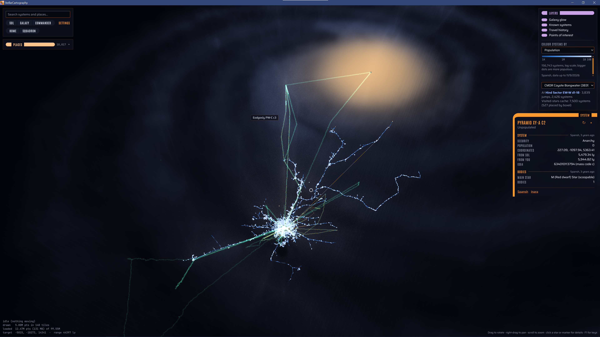

# StellarCartography    



Standalone galaxy map viewer for Elite: Dangerous. Intended for personal use, so YMMV


A desktop app (Tauri 2 + three.js) that renders every system in the EDSM
catalogue as a level-of-detail point cloud over a generated galaxy backdrop,
with your commander's travel history read live from the game's journal files.
It keeps its own copy of the catalogue (about 10 GB), built from EDSM's nightly
dump on first run and rebuilt from Settings whenever you like.

## Layout

| Path | What |
| --- | --- |
| `crates/galaxy-core` | Shared Rust: id64 decoding, octree tile format, journal parser |
| `crates/ingest` | Library + CLI: EDSM dump → `galaxy.sqlite`, `tiles/`, `density.png`; Spansh dump → `populated.bin` (the app runs the same builds) |
| `app/` | Vite + TypeScript + three.js frontend |
| `app/src-tauri` | Tauri backend: serves tiles, system search, journal watcher, settings, catalogue builds |
| `data/` | Generated data (gitignored) |

## Prerequisites (Windows)

- Rust (stable, MSVC toolchain) and the Visual Studio 2022 C++ Build Tools
- Node.js 20+ and pnpm
- WebView2 (ships with Windows 10/11)

## Run the viewer

```bash
cd app
pnpm install
pnpm tauri dev
```

(In Windows PowerShell with the default script policy, use `pnpm.cmd` in place of `pnpm`.)

To debug by hand, run `debug.bat` (or double-click it). It starts the Vite dev
server in a window of its own and a debug build of the app in the current one,
with Rust backtraces on. When the app closes, press R to rebuild and restart it
while the dev server keeps running, or Q to stop both. In the app, Ctrl+Shift+I
opens the WebView2 dev tools (so does right-click → Inspect on a panel; the map
keeps right-click for panning).

A splash covers the window while the map loads in, with a line from Captain
Picard picked at random. It lifts once the opening view is drawn and the quote
has had time to be read; a click or a key press lifts it sooner.

On first run the app offers to **download and build** the catalogue (streams
about 3.4 GB from EDSM, nothing kept but the result; about 10 GB of data;
10–15 minutes), or to **use an existing build** folder. Later, Settings →
"Rebuild from EDSM…" refreshes it in the background while the map stays usable.
Once the catalogue, the map layers or the points of interest are over a week
old, a reminder offers to update them (Settings → Updates turns it off). Builds check free disk
space first.

The data folder is chosen in this order:
1. `STELLAR_DATA_DIR`, if set.
2. The folder saved in Settings.
3. A `data/` folder above the working directory or the executable. This is how a development checkout finds the repo's `data/`.
4. The app's own data folder, `%LOCALAPPDATA%\io.github.stellarcartography.viewer\data`.

The journal folder defaults to
`%USERPROFILE%\Saved Games\Frontier Developments\Elite Dangerous`. You can change it
in Settings, or override it with `ED_JOURNAL_DIR`. Settings are saved in
`%APPDATA%\io.github.stellarcartography.viewer\settings.json`.

## Keyboard

The map flies from the keyboard as well as the mouse. Every key can be
changed: press F1 (or Settings → Keyboard → "Change keys…"), click a key, then
press the new one. Esc cancels and Backspace clears it. Each action has two
keys. Giving an action a key another one had takes it from that one, and the
list says so. ↺ puts a row back to its defaults, and "Reset all keys" puts back
every row.

| Action | Keys |
| --- | --- |
| Move forward, back, left, right | W A S D, or the arrow keys |
| Move up, down (galactic north) | R, F, or Page Up, Page Down |
| Orbit left, right, up, down | Q, E, T, G |
| Zoom in, out | Z, X, or =, - |
| Jump to Sol, the whole galaxy, your commander, home, the squadron capital | 1 to 5 (C and Home also work for commander and home) |
| Galaxy glow, known systems, travel history, points of interest on/off | Shift+1 to Shift+4 |
| Search | / or Ctrl+F |
| Places open/closed | P |
| Settings | Ctrl+, |
| The list of keys | F1 or Shift+/ |

Moves keep to the galactic plane whichever way the camera looks, and their
speed scales with how far out you are. Keys work on the physical key, so WASD
stays in the same place on AZERTY and other layouts, and the list names keys
as your layout prints them. Keys do nothing while you type in a box, and only
the Settings and key-list keys work while one of those is open. Changed keys
are saved in settings.json under `keys`.

## Map layers

Layers → **Colour systems by** draws every populated system as a coloured dot
over the stars, which dim to make room:
- **Population**: one blue ramp, log scale from 1 thousand to 10 billion; bigger dots are more populous.
- **Allegiance**, **Government**, **Economy** and **Powerplay power**: up to three
  values in colour at once, everything else grey. Click a legend row to colour or
  grey it; the choice is saved. In the Powerplay layer, Fortified systems are drawn
  bigger and Strongholds biggest.
- **Security** and **Powerplay state**: one hue in steps, lowest darkest. Click a
  legend row to hide or show that level.
- **Minor faction**: find a faction by name to see every system it's in, coloured
  by influence, with the systems it controls drawn bigger.

Hovering a dot shows the system and its value; clicking it opens the system's
details. Only three colours are used at a time because, with dots side by side,
more than three hues can't all be told apart by colour-blind viewers.

The layers come from [Spansh](https://spansh.co.uk)'s
`galaxy_populated.json.gz`: the only dump that names each system's controlling
power. EDSM's Powerplay dump lists the powers present without saying which one
controls. The dump is about 4.7 GB. The app streams it, keeps about 17 MB as
`populated.bin` in the data folder, and needs about 5 minutes (mostly download).
The layers panel offers the first download. Settings → "Update from Spansh…"
refreshes it whenever you like (Powerplay moves weekly). Catalogue rebuilds don't
touch it.

## Points of interest

**Places**, under the search box, is a directory of notable systems, and
Layers → **Points of interest** draws them on the map as markers with name
labels close up:
- **Guardian sites** and **Thargoid sites**: every system where players have
  reported Guardian ruins, structures or beacons, or Thargoid structures,
  spires or barnacles in the codex. Systems known only from things found at
  sites (data logs, barbs) are included when they were reported after the
  codex's first weeks, when entries could be credited far from where they
  were found.
- **Carrier hubs**: systems with 10 or more fleet carriers seen in the last 30
  days, where players gather. Bigger markers mean more carriers.
- **Mysteries**, **outposts and megaships** (DSSA and other support carriers
  included), **nebulae**, **stellar phenomena**, **planets and life**, and
  **sights and history**, from the Galactic Exploration Catalog and EDSM's
  Galactic Mapping Project. **Planetary nebulae** (about 5,900 catalogue
  entries) start hidden.

Each category has its own marker shape, all in one colour, so none depends on
telling colours apart. Click a category to show or hide it, both in the list and
on the map. The list is sorted by distance from your commander, and the filter
matches names, systems and kinds ("guardian structure", "megaship"). The search
box finds places too. Clicking a place or a marker flies there and opens the
system, whose details list the places in it.

The places come from four files EDAstro publishes. Places → Download (or
Settings → Points of interest) streams about 900 MB, almost all of it codex
reports, keeps about 2 MB as `poi.json` in the data folder, and takes a few
minutes. Engineers aren't included: no community dataset publishes them.

## System details

Clicking a star opens a panel with what's known about the system:
- population, government, economy and security;
- Powerplay: the controlling power and its state, control progress and
  reinforcement/undermining, or each power's progress in an unoccupied system;
- minor factions, with influence, states, and any war or election;
- points of interest in the system;
- stations, with type, largest pad, distance and notable services;
- the main star and body count, and your own visits.

Each section says where it came from and how old it is:
- **Your journals** cover the systems you've visited, as they were when you were there.
- **[Spansh](https://spansh.co.uk)'s system API** covers any system and is the default online source.
- **[EDSM](https://www.edsm.net)'s APIs** are the fallback. EDSM has no Powerplay or landing pad data.

Whichever source saw a section last wins. Online answers are cached for an hour
in `%LOCALAPPDATA%\io.github.stellarcartography.viewer\details-cache.sqlite`.
Settings → System details switches the online source, or turns lookups off
(journal only).

## Build the galaxy data from the command line

The same build is available as a CLI, from the repository root:

```bash
cargo run --release -p ingest -- --out data
```

For a quick development dataset, `--limit 2000000` stops after the first 2M
records. `--sphere x,y,z,radius` keeps only systems inside a sphere, and
`--input file.json.gz` reads a local copy instead of downloading.

`--populated` builds `populated.bin` for the map layers from Spansh instead
(`--input` and `--limit` work there too):

```bash
cargo run --release -p ingest -- --populated --out data
```

`--poi` builds `poi.json` for the points of interest from EDAstro. With
`--input folder`, it reads local copies named `gec.json`, `edsmPOI.csv`,
`fleetcarriers.csv` and `codex-data.csv`:

```bash
cargo run --release -p ingest -- --poi --out data
```

## Installer

```bash
cd app
pnpm tauri build
```

This produces an unsigned per-user installer at
`target/release/bundle/nsis/StellarCartography_<version>_x64-setup.exe`. The
installed app won't find the repo's `data/` by itself: on first run, choose
"Already built? → Choose folder…" and pick the repository (or its `data` folder).

## Tests

```bash
cargo test --workspace
cargo clippy --workspace --all-targets -- -D warnings
pnpm --dir app typecheck
```

GitHub Actions ([.github/workflows/ci.yml](.github/workflows/ci.yml)) runs the
same checks on Windows on every push, after a frozen-lockfile install and a
frontend build. Pushes to `main` also build the installer and attach it to the
run as an artifact (kept 14 days); for any other branch, start the workflow
from the Actions tab with "Run workflow".

## Data and credits

- System catalogue: [EDSM](https://www.edsm.net) nightly dump `systemsWithCoordinates.json.gz`.
- System details: [Spansh](https://spansh.co.uk) and [EDSM](https://www.edsm.net) APIs, looked up per system on demand.
- Map layers: [Spansh](https://spansh.co.uk) dump `galaxy_populated.json.gz`.
- Points of interest: [EDAstro](https://edastro.com)'s Galactic Exploration
  Catalog, its copy of EDSM's Galactic Mapping Project, its fleet carrier list
  and its codex reports, all gathered by players.
- The galaxy glow ray-marches a density map built from id64 boxel indices. The
  idea comes from [spansh/elite-galaxy-map](https://github.com/spansh/elite-galaxy-map);
  the shader and data here are our own.
- Elite: Dangerous is © Frontier Developments plc. This project is not
  affiliated with or endorsed by Frontier.
