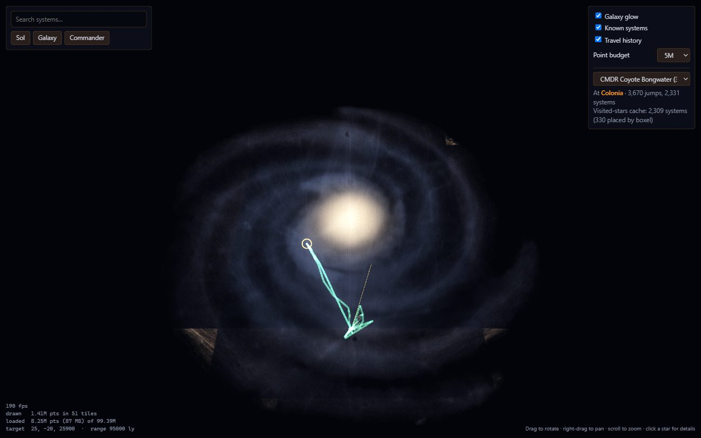
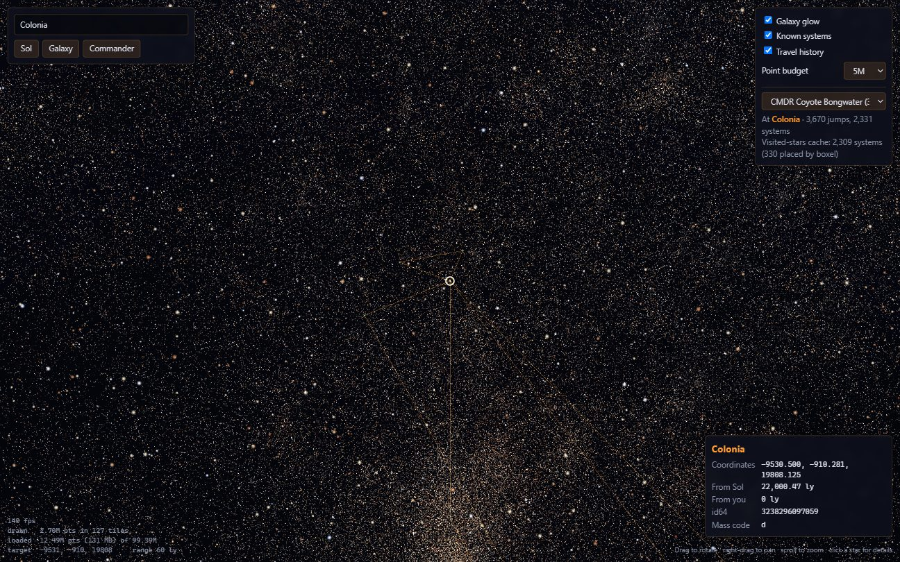
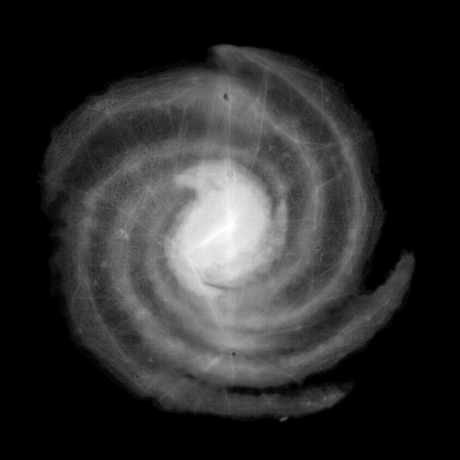
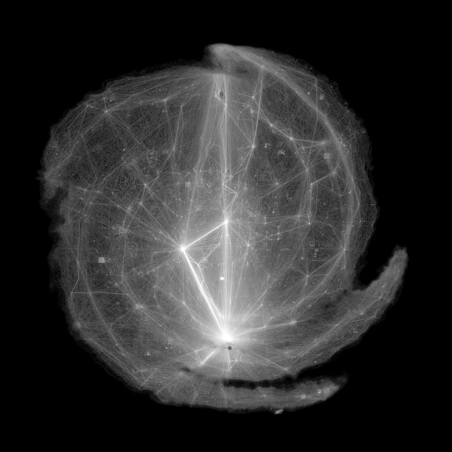
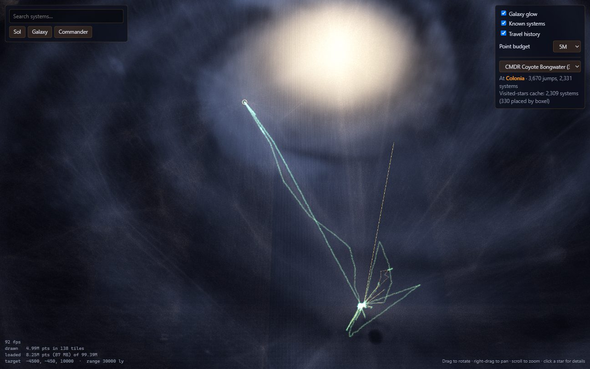

# StellarCartography: feasibility report

*Standalone Elite: Dangerous galaxy map viewer · prototype findings · 30 October 2026*

## Verdict: feasible, go

A standalone viewer that shows the whole known galaxy, with your own commander
on top of it, is feasible. The prototype in this repository does it today on a
Windows desktop:

- It renders **99.4 million systems** at interactive frame rates.
- It finds any system by name in a few milliseconds.
- It tracks your commander's position live from the game's journal.

The main correction to the original idea: **the Frontier API can't be the data
source for the map.** It only returns data about the logged-in commander. The
galaxy itself has to come from community data (EDSM for now). Frontier's API is
an optional extra for commander data, and the local game files already provide
most of that without it.

The open question is **distribution, not rendering**. The prototype builds
about 9.7 GB of local data from a 3.4 GB download. That's fine for development
but not something to ask of users. See [Alternatives to look at later](#alternatives-to-look-at-later).



## What the prototype does

- **Galaxy catalogue:**
  - The ingest streams EDSM's nightly `systemsWithCoordinates.json.gz` and writes three outputs:
    - a SQLite database for name search and id64 lookups;
    - an octree of point tiles for rendering;
    - two density maps.
  - The raw dump is never written to disk.
- **Renderer:**
  - three.js, inside a Tauri 2 desktop app.
  - Tiles stream in by level of detail under a point budget, so only the visible part of the galaxy is loaded.
  - Stars are coloured by mass code (a = small, cool; h = large, hot).
- **Galaxy backdrop:**
  - A ray-marched glow, built from our own density map. No Frontier artwork is used.
- **Search, fly-to and click-to-identify:**
  - The info panel shows coordinates, distance from Sol and from you, id64 and mass code.
- **Commander layer:**
  - Travel route and current-location marker, from all journal files.
  - New jumps appear within about 2 seconds while the game runs.
  - Visited systems come from the game's own `VisitedStarsCache.dat`, decoded as part of this work.



## Data sources

### Frontier Companion API (CAPI): commander data only

| | |
| --- | --- |
| **Provides** | `/profile` (current system with its id64), `/journal` (one day's journal, not real-time), `/fleetcarrier`, `/visitedstars` (a zip of `VisitedStarsCache.dat`), `/market`, `/shipyard`, `/communitygoals`, `/squadron` |
| **Does not provide** | Any galaxy-wide system list, coordinates for systems you haven't visited, or galaxy map imagery |
| **Access** | Apply for a client ID in the Frontier Developer Zone (user.frontierstore.net); approval is "not instant" |
| **Auth** | OAuth2 with PKCE via `auth.frontierstore.net`; access tokens last about 4 hours, refresh tokens at most 25 days, then the user re-authorises |
| **Limits** | About one query a minute is the community norm; Frontier has said more than 2 queries a second may be throttled |
| **Etiquette** | User-Agent `EDCD-<AppName>-<version>` (`EDCD-StellarCartography-0.1.0`) |
| **Hosts** | `companion.orerve.net` (Live), `legacy-companion.orerve.net` (Legacy) |

**Verdict:** CAPI is worth adding for players on consoles, or on another
machine, where the journal files aren't local. A PC player running the viewer
alongside the game gets the same data from local files, live and without a
login. The prototype has a `CommanderSource` trait ready for a `CapiSource`.
Building it waits on a client ID, which we don't have yet.

### Local game files: commander data without an API

- **Journal** (`%USERPROFILE%\Saved Games\Frontier Developments\Elite Dangerous\Journal.*.log`):
  - `FSDJump`, `CarrierJump` and `Location` events carry the system name, id64 and exact coordinates.
  - The prototype reads 323 files (3,670 jumps) and polls the newest one every second.
- **`VisitedStarsCache.dat`** (`%LOCALAPPDATA%\Frontier Developments\Elite Dangerous\<id>\`):
  - Undocumented, but it decoded quickly (format below).
  - It's the same file CAPI's `/visitedstars` returns, so this parser serves both routes.
  - It lists 2,309 systems for this account. **330 of them (14%) aren't in EDSM at all**: visited, but never uploaded. The prototype places those at their id64 boxel centre (accurate to half a boxel, 5–640 ly).

### EDSM: the galaxy catalogue (chosen for now)

| | |
| --- | --- |
| File | `https://www.edsm.net/dump/systemsWithCoordinates.json.gz`, rebuilt nightly |
| Size | 3.44 GiB compressed (3,694,367,811 bytes), last modified 30 Oct 2026 07:25 GMT |
| Records | 99,390,303 systems with id64, name and coordinates; 0 malformed, 0 outside the galaxy box |
| Format | A JSON array with one object per line, which streams easily |
| Range requests | Supported, so an interrupted download can resume (the ingest does this) |

### Considered but not used now

- **Spansh full dump** (`galaxy.json.gz`):
  - About 110 GiB, including bodies and stations.
  - Ruled out: too big to work with locally, and unreasonable to ask users to download.
- **Spansh delta dumps:** 1-day, 7-day and 1-month files of 1.1–5.2 GiB. An update option for later.
- **EDDN:** a live ZeroMQ feed of player journal events with `StarPos`. The natural way to keep a hosted catalogue fresh; not needed for a local prototype.

## Measurements

Test machine:
- Windows 10, 24 threads, 62 GB RAM, NVIDIA RTX 4070 Ti SUPER.
- WebView2 (Edge 156) on a 240 Hz display, so 240 fps is the ceiling.

### Ingest (full EDSM dump, streamed from edsm.net)

| Stage | Time | Output |
| --- | --- | --- |
| Download, decompress and parse | 219 s (454k records/s, ~17 MB/s compressed) | 99.4M systems |
| Octree build | 8 s | 8,592 tiles |
| Density maps | 3 s | 51.7M distinct boxels |
| SQLite indexes (name, id64) | 456 s | the slowest step; runs alongside the octree build |
| **Total** | **677 s (11.3 min)** | |

| Output | Size |
| --- | --- |
| `galaxy.sqlite` | 8.71 GiB |
| `tiles/` | 1.02 GiB (11 bytes per system) |
| `density.png` + `coverage.png` | 3.5 MB |

### Rendering

| View | Point budget | Points drawn | Tiles | Avg fps | p95 frame |
| --- | --- | --- | --- | --- | --- |
| Whole galaxy (95,000 ly) | any | 1.41M | 51 | 240 (capped) | 4.3 ms |
| Sol bubble (400 ly) | 2M | 2.00M | 61 | 239 | 4.3 ms |
| Sol bubble | 5M (default) | 5.00M | 171 | 186 | 12.5 ms |
| Sol bubble | 10M | 10.0M | 379 | 114 | 20.8 ms |
| Sol bubble | 20M | 12.7M* | 516 | 99 | 20.8 ms |

\* At 20M the selection runs out of tiles worth refining before it runs out of budget.

Other render figures:
- **Tile streaming:** newly visible tiles settle within about 0.5–1 s. A session holds 50–160 MB of tiles.
- **Bandwidth implication:** if the tiles were hosted rather than local, a typical session would download roughly that 50–160 MB, not 1 GB.

### Interaction

| Operation | Time |
| --- | --- |
| Prefix search over 99.4M names ("Sol", "Col 285 Sector", "Beagle Point") | 2–4 ms |
| Click-to-identify (CPU scan of 5M drawn points) | 45 ms |
| Commander history to the UI (journals are parsed once at startup) | 21 ms |
| Visited-stars cache: decode, plus 2,309 id64 lookups (debug build) | 110 ms |
| New journal jump to marker moved | ≤ 2 s (1 s poll) |

## Findings worth keeping

**id64 reveals the galaxy's shape without Frontier artwork.**
- Every system address encodes its boxel and its index within that boxel.
- The highest index seen in a boxel is therefore a lower bound on how many systems it holds.
- Summing those bounds across the 51.7M boxels EDSM has touched recovers the spiral arms and core (left).
- A plain count of EDSM systems mostly shows where players have travelled (right).
- The left-hand map drives the backdrop glow.

| id64-estimated density (used) | Raw EDSM coverage |
| --- | --- |
|  |  |

**id64 decoding.**
- Starting from the low bits: mass code (3 bits), then boxel z (14−mc), boxel y (13−mc), boxel x (14−mc), the system index (11+3·mc), and the body (9 bits).
- Boxels are `10·2^mc` ly on a grid anchored at (−49985, −40985, −24105).
- Checked against six known systems, including Sol and Sagittarius A*.

**`VisitedStarsCache.dat` (version 200).**
- **Header:**
  - The magic `"VisitedStars"`, padded to 16 bytes.
  - Four u32 fields: version, header length (48), record count, record length (16).
  - Two u64 account/commander ids.
- **Records:** 16 bytes each: `u64 id64`, `u32 visit count`, `u32 last visit` (days since 1601-01-01).
- **Trailer:** `0x5AFEC0DE` written twice.
- Implemented in [`crates/galaxy-core/src/visited.rs`](../crates/galaxy-core/src/visited.rs).

**Coordinates.**
- The game's frame is left-handed. Flipping z (`x, y, −z`) displays it in three.js without mirroring.
- Coordinates are exact multiples of 1/32 ly, so SQLite stores them as integers.



## Known issues in the prototype

- **Seams between detail levels.**
  - Neighbouring tiles at different octree depths have visibly different star densities, and additive blending makes the denser ones brighter.
  - Fading stars at long range hides most of this, but some seams still show in mid-range views.
  - Fix: weight each point's brightness by how many stars it stands in for (Potree-style adaptive point size), or render into an HDR buffer with tone mapping.
- **Bright saturation in dense regions.**
  - Looking along the galactic plane from inside the bubble blows out to white. The same HDR and tone-mapping fix applies.
- **Picking is a CPU scan.** 45 ms is fine for clicks but too slow for hover. A GPU id-buffer pick would fix that.
- **SQLite index build is 2/3 of ingest time.** Inserting in name order, or building the indexes in parallel, would cut it.
- **Tested on one machine and GPU.** Integrated GPUs will need a lower default point budget (2M).
- **Windows only.** Journal and cache paths are Windows paths; Tauri itself is cross-platform.

## Licensing and IP

- **Frontier assets:**
  - We use no game assets.
  - The galaxy backdrop is generated from catalogue data, and the UI is our own.
  - "Elite: Dangerous" is © Frontier Developments plc; the README says the project is unaffiliated.
- **EDSM data:** the dump's terms of use **still need confirming**. The EDSM pages couldn't be fetched during this investigation. This matters most before we host or redistribute derived tiles.
- **CAPI:** Frontier's developer terms are accepted when applying for a client ID; review them then.
- **Third-party code:**
  - **spansh/elite-galaxy-map (MIT):** we took only the idea of ray-marching a density map; no code was copied.
  - **Elite-Dangerous-Almanac/Galaxy-Map:** licensed PolyForm Noncommercial. We avoided it on purpose, to keep commercial options open.

## Risks and open questions

1. **Distribution size** (the main one): 3.4 GB download, 11 minutes of ingest and 9.7 GB on disk per user.
2. **Reliance on EDSM:** a single community service; availability and future maintenance aren't guaranteed. The ingest's input format is simple to swap.
3. **Catalogue gaps:** 14% of this commander's visited systems are missing from EDSM. Expect more for explorers. Boxel placement covers the gap approximately.
4. **CAPI approval timeline:** unknown. It only blocks the console/remote-player use case.
5. **Dump growth:** EDSM grows daily; tiles and SQLite scale linearly (about 11 bytes per system for tiles, about 94 bytes for SQLite).

## Alternatives to look at later

Ways to avoid a per-user 9.7 GB build, roughly in order of promise:

1. **Hosted static tiles (recommended to try first):**
   - Publish `tiles/` (1 GB) and the density map on a CDN, rebuilt nightly by the same ingest.
   - The app streams only visible tiles, about 50–160 MB per session as measured.
2. **Search without the 8.7 GB database:**
   - Option (a): a small hosted search API.
   - Option (b): a sharded client-side name index downloaded on demand. Names are most of the SQLite size.
3. **EDSM API on demand** for search and lookups, if its rate limits allow.
4. **Delta updates:** EDSM's 7-day dump (5.7 MB) or Spansh deltas, or EDDN for live updates to a hosted catalogue.
5. **Lite mode:** density backdrop plus populated systems only (`systemsPopulated.json.gz`, 0.5 GB), with the full catalogue as an optional download.

## Rough effort to an MVP

These are estimates for one developer, building on the prototype:

| Work | Estimate |
| --- | --- |
| Hosted tile pipeline (nightly ingest job, CDN upload, app fetches remotely) | 1–1.5 weeks |
| Search without local SQLite (hosted API or sharded index) | 1 week |
| LOD brightness weighting, HDR/tone mapping, GPU picking | 1 week |
| CAPI source (PKCE login, keychain token storage, `/profile` and `/visitedstars`), once a client ID exists | 3–5 days |
| Settings, first-run flow, error states, installer and code signing | 1 week |
| Testing on low-end GPUs and on macOS/Linux | 3–5 days |
| **Total** | **about 5–6 weeks** |

## Recommended next steps

1. **Apply for a Frontier CAPI client ID now**, since approval takes time. Use the app name `StellarCartography`.
2. **Confirm EDSM's terms** for redistributing derived data before hosting tiles.
3. Prototype **hosted tiles**: publish this ingest's `tiles/` to a static bucket and point the app at it.
4. Fix the **LOD brightness weighting**; it's the most visible quality issue.

## Reproducing this

```bash
# Build the data (streams from EDSM; about 11 minutes, 9.7 GB in data/)
cargo run --release -p ingest -- --out data

# Run the viewer
cd app && pnpm install && pnpm tauri dev

# Tests
cargo test --workspace
pnpm --dir app typecheck
```

Raw numbers from the ingest run are written to `data/ingest-stats.json`.
